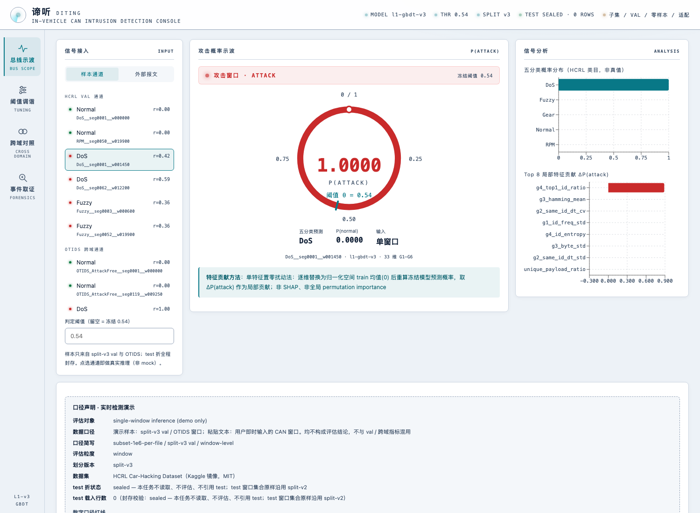
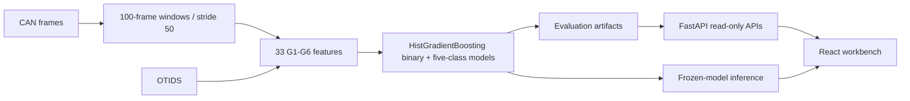
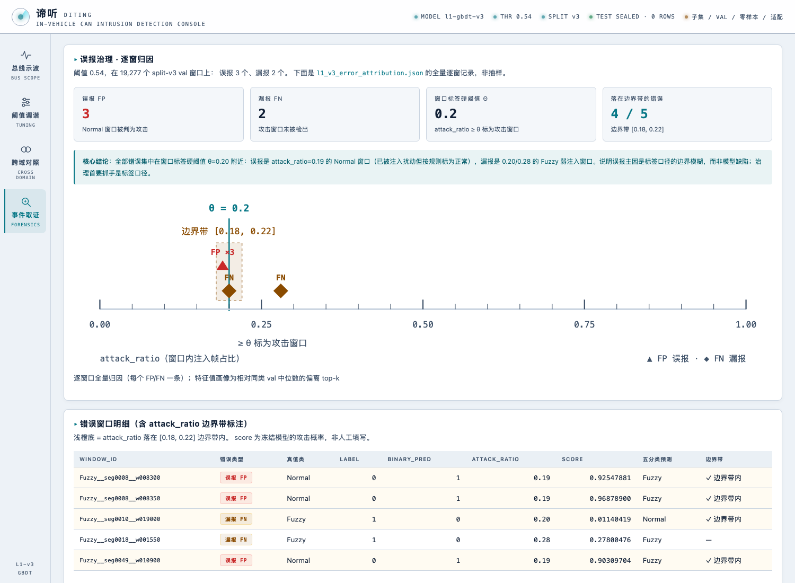

# 谛听 · Diting

**可解释的车载 CAN 总线入侵检测、跨域评估与本地分析工作台。**

**Interpretable CAN bus intrusion detection with cross-domain evaluation and a local analysis workbench.**


## 项目简介

谛听将 CAN 帧转换为固定窗口，提取 33 维统计特征，训练二分类攻击检测与五分类攻击识别模型，并通过 FastAPI + React 工作台提供真实冻结模型推理、阈值分析、跨数据集评估和逐窗口误差归因。

- **真实推理**：支持注册验证样本与 candump 文本输入，返回攻击概率、五分类概率及局部特征贡献。
- **跨域评估**：冻结模型、阈值、归一化参数与 ID 频率，在 OTIDS 上进行零样本评估。
- **评估治理**：采用按片段划分、训练集归一化、阈值冻结与测试集封存，明确区分验证结果和适配上限。
- **本地运行**：无需数据库、账户系统或外部运行时服务，附带前端构建产物和演示所需派生数据。

## English overview

Diting processes CAN frames into fixed windows, extracts 33 statistical features, and trains binary attack detection and five-class attack recognition models. A FastAPI + React workbench provides real frozen-model inference, threshold analysis, cross-dataset evaluation, and per-window error attribution.



## Highlights

- **Real model inference**: run registered validation windows or paste candump text; responses include attack probability, five-class probabilities, and top local feature contributions.
- **Interpretable features**: 33 G1–G6 features covering DLC, ID frequency, frame intervals, payload statistics, periodicity, and window changes.
- **Evaluation governance**: segment-aware splitting, train-only normalization, a frozen threshold, and a sealed HCRL test partition.
- **Cross-domain analysis**: apply the same frozen model and preprocessing parameters to OTIDS without retraining.
- **Error attribution**: inspect every false positive and false negative together with the window-label boundary band.
- **Local-only workbench**: read-only artifact APIs plus one inference endpoint; no database, account system, or external service is required at runtime.

## Architecture



Training and serving share the same `compute_window_features` and `apply_normalization` implementations.

## Verified results

All figures are **window-level** results from the included evaluation artifacts.

| Evaluation scope | Threshold | Windows | F1 | AP |
|---|---:|---:|---:|---:|
| HCRL split-v3 validation subset | 0.54 | 19,277 | **0.999736** | 0.999999 |
| OTIDS zero-shot with fully frozen model and preprocessing | 0.54 | 92,013 | **0.914101** | 0.99983824 |
| OTIDS threshold adaptation upper bound — **not zero-shot** | 0.05 | 46,005 | **0.998172** | 0.99986133 |

HCRL validation confusion matrix: **TP 9,463 / FP 3 / TN 9,809 / FN 2**. Five-class macro-F1 is **0.999693** on the same-distribution validation subset.

The workbench also compares against the L0 rule baseline, whose F1 is 0.936286 under the same validation scope.

### Reporting boundaries

- HCRL results use a real-data subset consisting of the first 1,000,000 rows per file; they are not full-dataset or frame-level results.
- Zero-shot means model weights, threshold, normalization parameters, and ID frequencies are all frozen before OTIDS evaluation.
- Threshold adaptation uses OTIDS adaptation data and must not be reported as zero-shot performance.
- OTIDS does not provide the truth labels required for a comparable five-class macro-F1.
- The HCRL test partition remains sealed and is not loaded by the workbench.



## Run locally

Requirements: Python 3.11+ and [uv](https://docs.astral.sh/uv/). The frontend production build is included, so Node.js is not required for normal use.

```bash
git clone https://github.com/Yu-Peng-Tu/diting.git
cd diting

uv venv .venv
uv pip install --python .venv/bin/python -e ".[dev]"

OMP_NUM_THREADS=1 OPENBLAS_NUM_THREADS=1 MKL_NUM_THREADS=1 NUMEXPR_NUM_THREADS=1 \
  .venv/bin/python -m uvicorn diting.server.app:app --host 127.0.0.1 --port 8765
```

Open **http://127.0.0.1:8765**. API documentation is available at **http://127.0.0.1:8765/docs**.

The service binds to localhost. Keep it on a trusted local machine; the candump input is intended for local interactive use.

## Development

Rebuild the frontend:

```bash
cd web
npm ci
npm run build
```

Run verification:

```bash
.venv/bin/python -m pytest -q
.venv/bin/python -m ruff check .
cd web && npm run build
```

Current verification status: **102 pytest tests passed, 2 skipped** (104 collected), Ruff passed, and the TypeScript production build passed.

## API

| Method | Endpoint | Purpose |
|---|---|---|
| GET | `/api/health` | Model metadata and test-partition sealing declarations |
| GET | `/api/metrics/summary` | Same-distribution and cross-domain metrics |
| GET | `/api/curves/pr` | 6,917 PR-curve points |
| GET | `/api/curves/threshold` | 91 threshold-grid points with TP/FP/TN/FN |
| GET | `/api/ablation` | Feature-group and ID-frequency ablations |
| GET | `/api/errors` | Five per-window error-attribution records |
| GET | `/api/samples` | Registered validation and OTIDS demo windows |
| POST | `/api/detect` | Frozen-model inference from a sample ID or candump text |

Responses include evaluation scope, artifact sources, caveats, and `test_rows_loaded=0`.

## Repository layout

```text
src/diting/             Data, features, splitting, models, evaluation, and server
web/                    Vite + React + TypeScript + Recharts
configs/                Reproduction configurations
artifacts/              Frozen model and evaluation JSON required by the workbench
data/processed/         Compact derived window tables required for local demos
tests/                  Backend, feature, leakage, cross-domain, and API tests
docs/images/            Workbench screenshots
```

Raw CAN datasets are **not redistributed**. The included Parquet files are derived window tables used by the local workbench. Rebuilding artifacts from original datasets requires downloading them separately and updating the input paths in `configs/`.

Dataset references:

- [HCRL Car-Hacking Dataset](https://ocslab.hksecurity.net/Datasets/car-hacking-dataset)
- [OTIDS](https://ocslab.hksecurity.net/Dataset/CAN-intrusion-dataset)

Dataset rights and citation requirements remain with their original providers.

## Limitations

- Offline research software, not an automotive safety-certified or production vehicle security system.
- Cross-dataset results combine changes in vehicle, collection environment, and timestamp conventions; they do not isolate a single causal factor.
- Local feature contributions use single-feature zero perturbation in normalized space; they are not SHAP values or global feature importance.
- The demo catalog currently emphasizes Normal, DoS, Fuzzy, and OTIDS Impersonation windows; five-class evaluation artifacts remain available independently.
